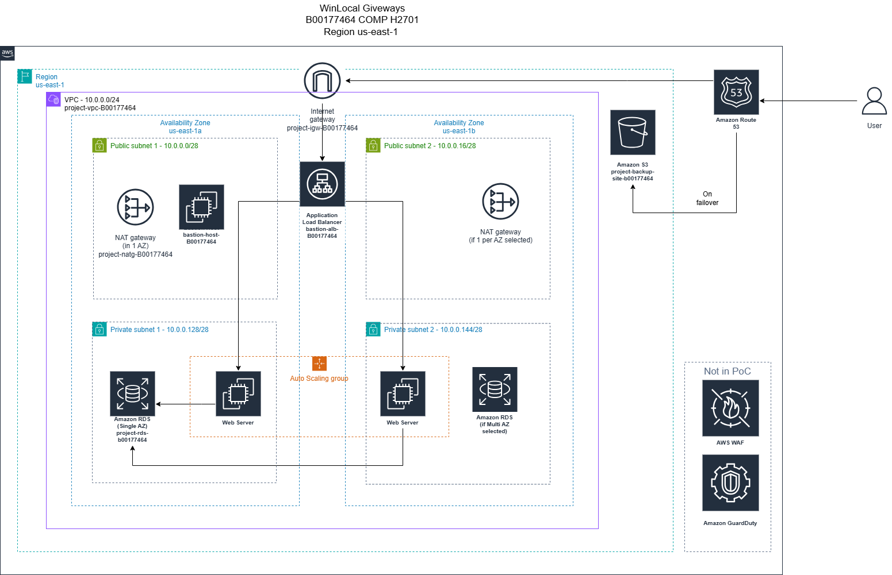
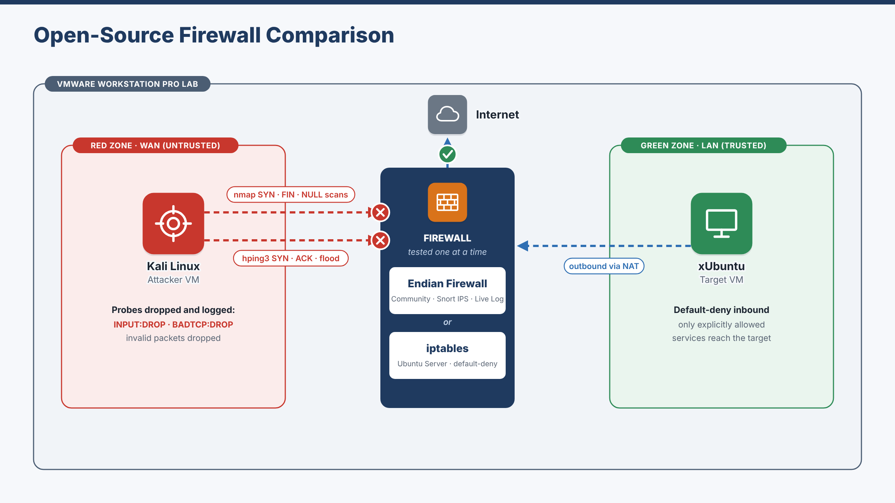
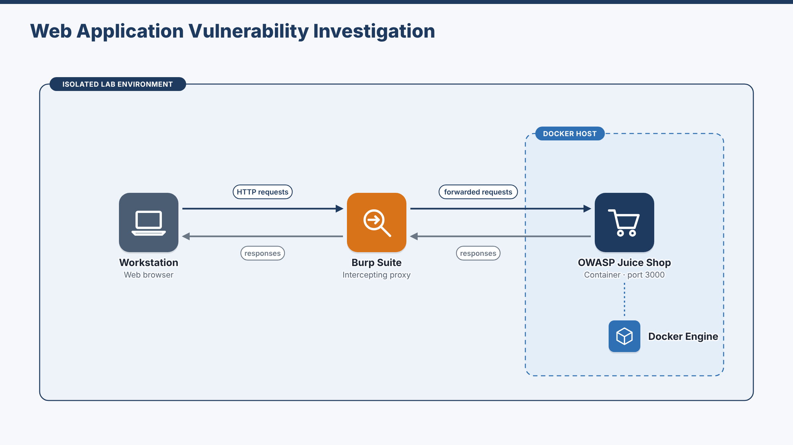

# Stepan Tretiakov — Cyber Security Portfolio

Third-year **Digital Forensics and Cyber Security** student at **TU Dublin** (GPA 3.8 / 4.0), with a strong interest in cloud security and AWS. Winner of the **Cloud Computing** category at **WorldSkills Ireland 2025**.

This repository is the starting point for my project work. Each project has its own folder with a README that explains its purpose, the tools used, **what I personally contributed**, and screenshots as evidence.

---

## Featured projects

| # | Project | What it is | Type | Key tools |
|---|---------|------------|------|-----------|
| 1 | [**Secure AWS Cloud Migration**](aws-secure-cloud-migration/) | Designed and built a secure, scalable AWS proof of concept to migrate a start-up after a ransomware breach: segmented VPC, bastion host, Auto Scaling behind an ALB, private RDS, and Route 53 failover to S3 | Individual | VPC, EC2, Auto Scaling, ALB, RDS, S3, Route 53, security groups |
| 2 | [**Open-Source Firewall Comparison**](firewall-comparison-endian-vs-iptables/) | Attacked Endian Firewall Community and iptables with the same scans in a virtual lab and compared enforcement, logging, usability and performance | Pair (I led Endian and the attack testing) | Endian, iptables, Kali Linux, nmap, hping3, VMware |
| 3 | [**Web Application Vulnerability Investigation**](owasp-juice-shop-web-app-security/) | Solved five advanced OWASP Juice Shop challenges and analysed Sensitive Data Exposure and Security Misconfiguration against OWASP Top 10 and CWE | Group of four (my part is described in full) | Burp Suite, DevTools, John the Ripper, OSINT, ExifTool, Docker |

  
  
  

---

## Skills

- **Security:** network security, firewall configuration and testing, intrusion prevention, web application security testing, SQL injection, password cracking, OSINT, OWASP Top 10, MITRE CWE
- **Cloud (AWS):** VPC design, EC2, AMIs and launch templates, Auto Scaling, Application Load Balancer, RDS, S3, Route 53, IAM, security groups, Lambda, DynamoDB
- **Systems and networking:** Linux / Unix, Windows, VMware, Docker, TCP/IP, DNS, DHCP, subnetting, NAT, routing
- **Tools:** Burp Suite, nmap, hping3, John the Ripper, Kali Linux, Endian Firewall, iptables, ExifTool, draw.io
- **Scripting:** Python, Bash, PowerShell, SQL

## Achievements and certifications

- **WorldSkills Ireland 2025 — Cloud Computing, Winner** (national final, individual competition)
- CTFs, hackathons, AWS Jams and GameDays (TU Dublin, TUD HackerSoc, Amazon-sponsored events), 2024–2026
- Cisco — *Introduction to Cybersecurity* (2024)
- NVIDIA — *Fundamentals of Deep Learning* (2024)

---

*No passwords, keys, account identifiers or other sensitive data are published in this repository. Screenshots have been reviewed and redacted where needed. Teammates are not named, to respect their privacy.*
