# Secure AWS Cloud Migration — Architecture Design & Proof of Concept

> Designed and built a secure, scalable proof-of-concept AWS architecture to migrate a fictional start-up, *WinLocal Giveaways*, from a failing on-premises data centre to the cloud.

**Context:** Security Architecture module (COMP H2701), TU Dublin · **Type:** Individual project · **Date:** May 2026

[← Back to portfolio](../README.md)

---

## Purpose

WinLocal Giveaways, a Dublin start-up running online competitions, had outgrown its on-premises infrastructure. It suffered availability failures, could not scale, and had been hit by a **ransomware attack** that went undetected for about ten weeks because its flat network allowed free lateral movement.

The goal was to design an AWS architecture that fixes these four problems (availability, database reliability, scalability and security), build a working proof of concept (PoC), and justify further services beyond the PoC.

## Architecture

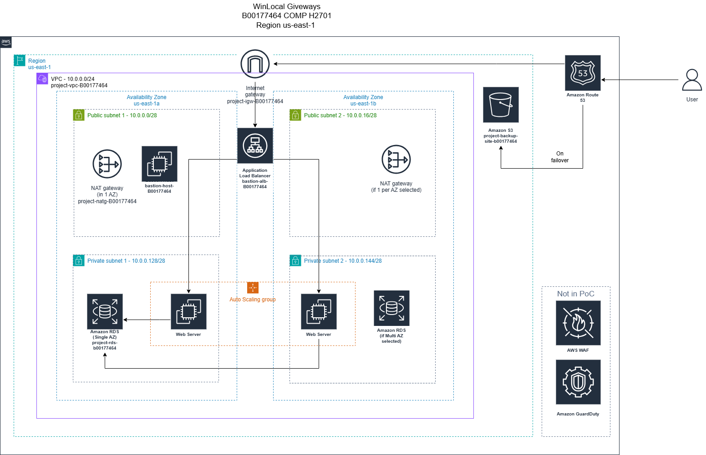

*My architecture diagram, drawn in draw.io with the official AWS icon set. Components marked "Not in PoC" are part of the proposed design but were not built.*

| Layer | What I built |
|-------|--------------|
| **Network** | VPC `10.0.0.0/24` in us-east-1 across **two Availability Zones**, with two public and two private `/28` subnets, an internet gateway, a NAT gateway, and separate public and private route tables |
| **Access** | **Bastion host** in a public subnet as the only SSH entry point, with SSH allowed from a single trusted IP |
| **Web tier** | Web server configured with User Data, captured as a custom **AMI**, then deployed through a **launch template** and an **Auto Scaling group** (min 1, max 2, target-tracking at **60% average CPU**) in the private subnets |
| **Load balancing** | **Application Load Balancer** across both public subnets, distributing HTTP traffic to the web servers |
| **Database** | **Amazon RDS (MySQL)** in a DB subnet group spanning both private subnets, with public access disabled. Single-AZ for the PoC, Multi-AZ-ready |
| **Resilience** | **Route 53 failover routing**: the ALB is primary; if its health check fails, traffic goes to a **static backup website on Amazon S3** |
| **Security** | Four **least-privilege security groups** chained together (see below) |
| **Proposed, not in PoC** | **AWS WAF** in front of the ALB, and **Amazon GuardDuty** for continuous threat detection |

### Security group design

| Security group | Allows inbound | From |
|----------------|----------------|------|
| ALB | HTTP 80, HTTPS 443 | Internet |
| Web servers | HTTP 80 / HTTPS 443 | **ALB security group only** |
| Web servers | SSH 22 | **Bastion security group only** |
| RDS | MySQL 3306 | **Web server security group only** |
| Bastion | SSH 22 | One trusted IP address |

Each tier can only be reached from the tier in front of it. Even if one component is compromised, an attacker still faces another layer before reaching the database. This is the opposite of WinLocal's flat network, which let the ransomware spread.

## My contribution

Individual project. I designed the full cloud architecture and the diagram, then built and tested the proof of concept in AWS myself: the segmented VPC, bastion access, custom AMI and Auto Scaling web tier behind the load balancer, the RDS database, the four security groups, and Route 53 failover to the S3 backup site. I also wrote the justification for AWS WAF and GuardDuty and the sustainability evaluation.

## What I did

1. Designed the target architecture around the AWS Well-Architected Framework, with network isolation, least privilege and resilience as the main goals.
2. Built the VPC, the four subnets across two Availability Zones, the route tables, the internet gateway and the NAT gateway.
3. Deployed the bastion host and confirmed SSH access to private web servers worked only through it.
4. Configured a web server, created an AMI from it, and used a launch template and Auto Scaling group with a CPU target-tracking policy.
5. Deployed RDS MySQL in the private subnets and confirmed the web application could read data from it.
6. Placed the Application Load Balancer in front of the web tier.
7. Hosted a static "temporarily unavailable" page on S3 and set up Route 53 failover records (ALB primary, S3 secondary).
8. Justified AWS WAF (blocking OWASP Top 10 attacks at the edge) and Amazon GuardDuty (detecting threats like the ten-week undetected breach) as next steps.

## Tools and technologies

Amazon VPC, subnets, route tables, internet gateway, NAT gateway · Amazon EC2 (Amazon Linux 2023), AMI, launch template, Auto Scaling · Application Load Balancer · Amazon RDS for MySQL · Amazon S3 static website hosting · Amazon Route 53 failover routing · security groups · bastion host · draw.io (AWS icons)

## Evidence

All screenshots are from my own AWS environment. I've redacted the account ID and database endpoint.

| | |
|---|---|
| 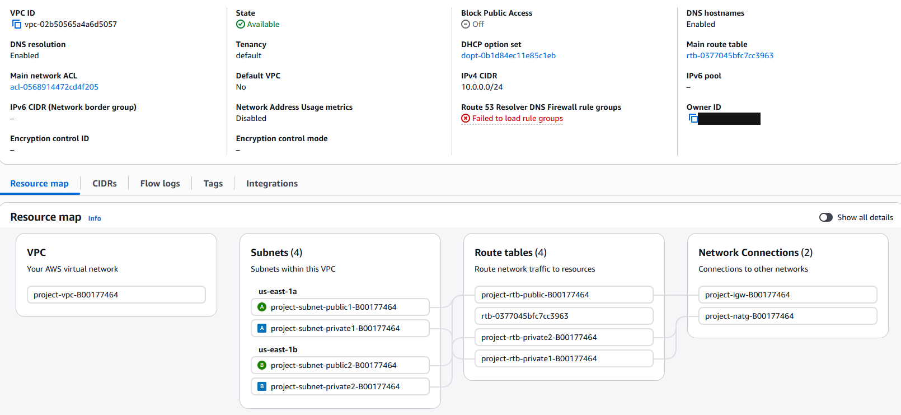 **VPC resource map**: four subnets in two AZs, route tables, internet gateway and NAT gateway | 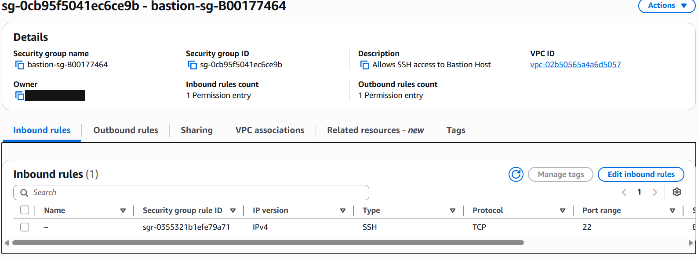 **Bastion security group**: SSH only |
| 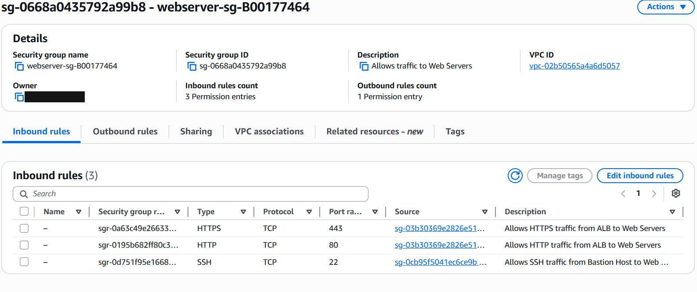 **Web server security group**: HTTP/HTTPS only from the ALB SG, SSH only from the bastion SG | 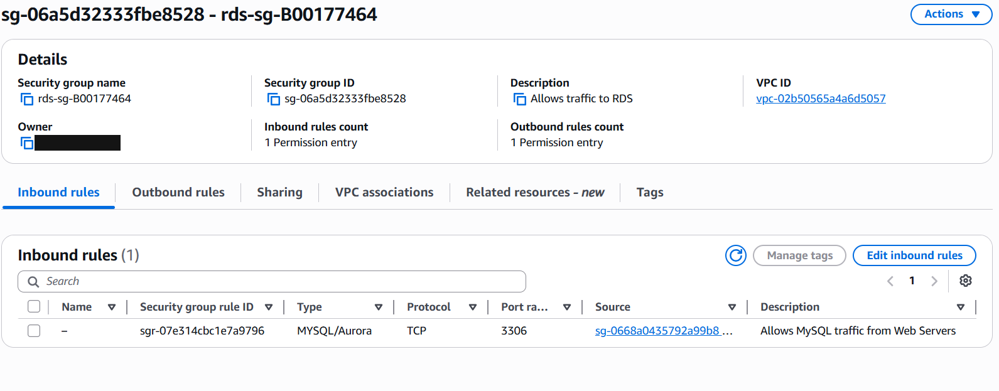 **RDS security group**: MySQL 3306 only from the web server SG |
| 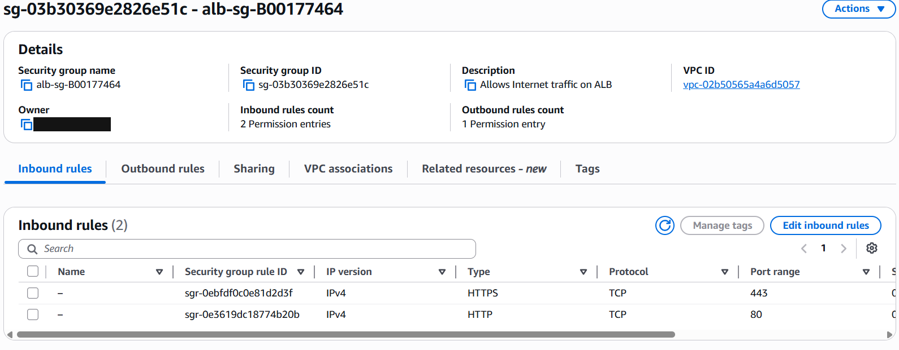 **ALB security group**: HTTP/HTTPS from the internet | 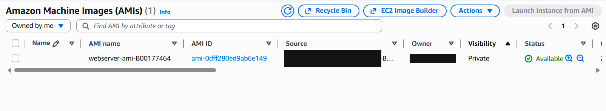 **Custom web server AMI** |
| 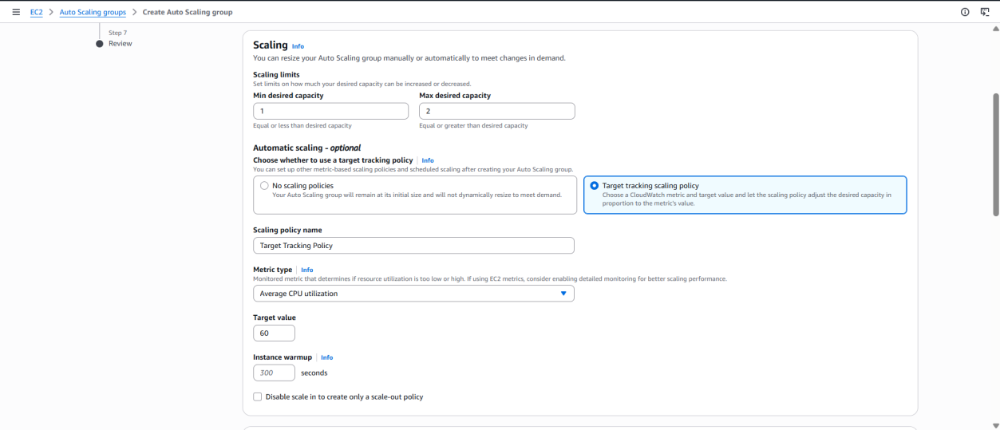 **Auto Scaling group**: min 1 / max 2, target tracking at 60% CPU | 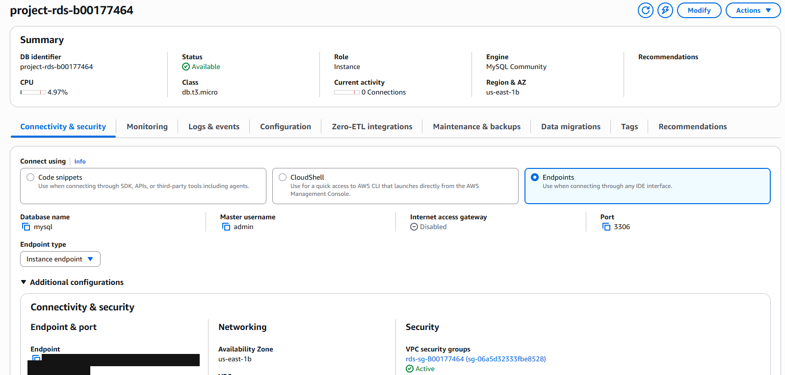 **RDS MySQL instance**, public access disabled |
| 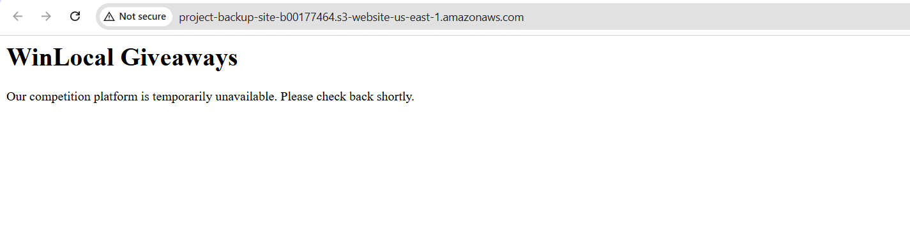 **S3 static backup website** ([page source](evidence/backup-site-index.html)) | 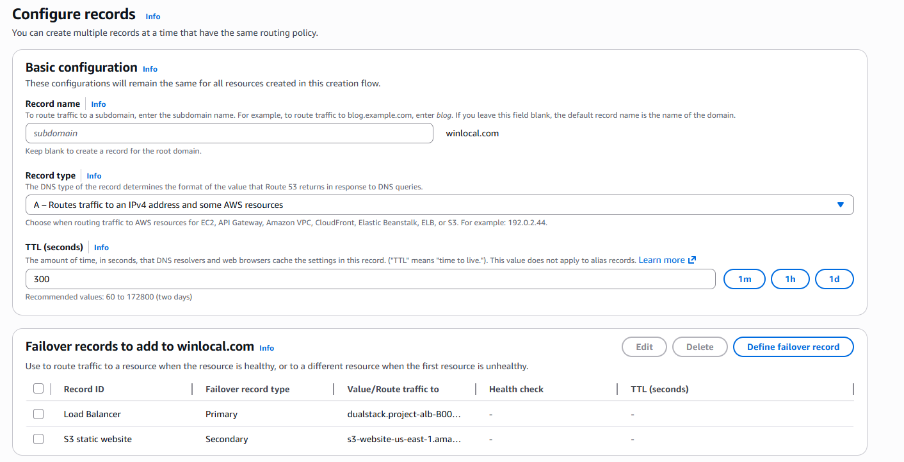 **Route 53 failover records**: ALB primary, S3 secondary |

## What I would improve next

- **Multi-AZ RDS and a second NAT gateway**, so the database and outbound access survive the loss of an Availability Zone. I left these out of the PoC to keep costs down.
- **HTTPS on the load balancer** with an ACM certificate, redirecting HTTP to HTTPS.
- **AWS Secrets Manager** for the database credentials instead of a configuration file on the web server.
- **Session Manager or SSH agent forwarding** instead of storing a private key on the bastion host.
- **AWS WAF and GuardDuty**, as proposed in the design.

## What this project demonstrates

Designing cloud infrastructure with security built in from the start (defence in depth, least privilege and high availability), building it hands-on in AWS, and linking each design decision to a real business problem. It builds on the AWS skills behind my WorldSkills Ireland 2025 Cloud Computing win.
