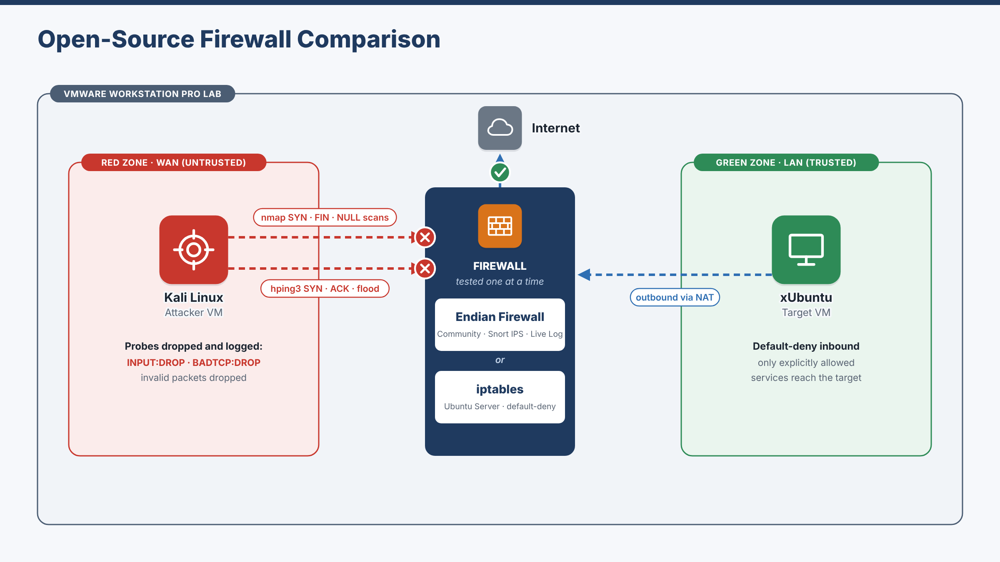
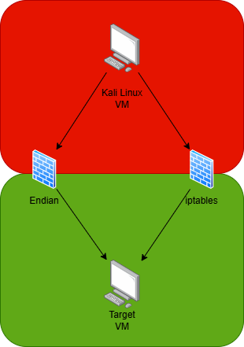
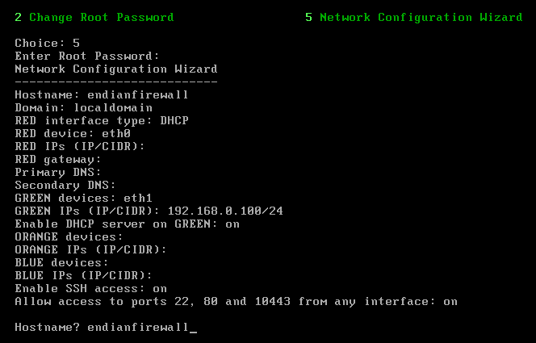
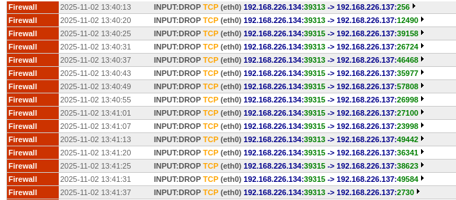
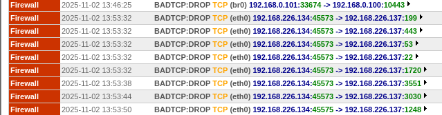
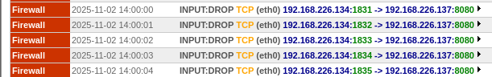
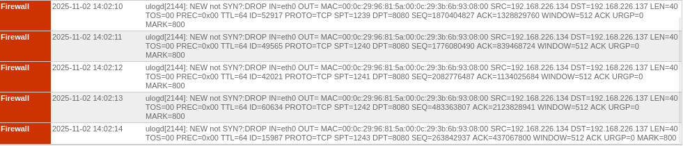
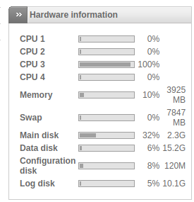

# Open-Source Firewall Comparison — Endian Firewall Community vs iptables

> Built a virtual test lab and attacked two open-source firewalls, the GUI-managed Endian Firewall Community and command-line iptables, with the same scans to compare how well each one enforces policy.

**Context:** Network Security module (CYSC H1001), TU Dublin · **Type:** Pair project with a classmate · **Date:** October–November 2025

[← Back to portfolio](../README.md)

---

## Purpose

Choosing a firewall means trading off ease of management, features, visibility and performance. We placed each firewall in the **same position** in the same network and ran the **same attacks** against it, so the comparison was fair and based on evidence rather than vendor claims.

## Test lab

| Component | Role |
|-----------|------|
| **VMware Workstation Pro** | Hypervisor hosting the whole lab |
| **Kali Linux VM** | Attacker, in the untrusted **RED (WAN)** zone |
| **Endian Firewall Community VM** | Firewall appliance: RED interface `eth0` (WAN), GREEN interface `eth1` (LAN) |
| **iptables VM** (minimal Ubuntu Server) | Second firewall, put in exactly the same position as Endian |
| **xUbuntu Desktop VM** | Target, in the trusted **GREEN (LAN)** zone |

**Endian configuration:**
- network wizard used to assign the RED and GREEN interfaces
- DHCP enabled on GREEN, and NAT for outbound traffic
- SSH management access, and the default inter-zone policy
- **Intrusion Prevention turned on**, with Snort rules
- the **Live Log** viewer set to show firewall events

**iptables configuration:**
- a clean rule set with a **default-deny** policy for `INPUT` and `FORWARD`
- loopback and `ESTABLISHED,RELATED` traffic allowed
- explicit allow rules for SSH (22), HTTP/HTTPS (80/443) and ICMP echo

## My contribution

Pair project. I set up and configured the Endian Firewall Community appliance (zones, DHCP, NAT, intrusion prevention and live logging), and I ran the attack tests from Kali with nmap and hping3, collecting the Endian Live Log evidence. My teammate led the iptables configuration and the main write-up. We analysed and compared the results together and presented them jointly.

## Tests and results

| Test | Command (from Kali) | Observed on Endian |
|------|---------------------|--------------------|
| TCP SYN scan | `nmap -sS <target>` | Probes dropped (`INPUT:DROP`) |
| Full-range SYN scan | `nmap -sS -p- -T4 <target>` | Probes dropped (`INPUT:DROP`) |
| Stealth FIN scan | `nmap -sF <target>` | Malformed packets dropped (`BADTCP:DROP`) |
| Stealth NULL scan | `nmap -sN <target>` | Malformed packets dropped (`BADTCP:DROP`) |
| Crafted SYN packets | `hping3 -S -p 8080 -c 5 <target>` | Dropped (`INPUT:DROP`, port 8080) |
| Crafted ACK packets | `hping3 -A -p 8080 -c 5 <target>` | Dropped as invalid (no matching connection) |
| SYN flood | `hping3 -S --flood -p 22 <target>` | Short CPU spike, flood packets dropped |

### Comparison

| Criterion | Endian Firewall Community | iptables |
|-----------|---------------------------|----------|
| **Policy enforcement** | Effective. The web UI and predefined objects reduce configuration mistakes | Equally effective when written correctly, but complex chains and NAT are easier to get wrong |
| **Configuration and repeatability** | GUI wizard, fewer syntax errors, config export/import | Needs scripting (`iptables-save`, Bash or Ansible) to be repeatable |
| **Logging and visibility** | Built-in Live Log and IDS alerts make events easy to match to rules | Raw logs need external collection and parsing, but are valuable for forensics |
| **Performance** | Extra services (web UI, IPS) use more CPU and memory | Lightweight, so better suited to high throughput |
| **Extensibility** | VPN, IDS and proxy included out of the box | Huge Linux ecosystem (fail2ban, nftables migration) |

**Conclusion:** both firewalls blocked unauthorised probing when correctly configured. Endian suits smaller teams that value easy management and built-in IPS and logging. iptables suits environments that need fine-grained control, scripted rule management and a small footprint.

## Evidence

| | |
|---|---|
|  **Lab topology**: Kali (RED) → Endian or iptables → target (GREEN) |  **Endian network configuration wizard**: RED/GREEN interfaces, DHCP, SSH access |
|  **nmap SYN scan**: every probe logged as `INPUT:DROP` |  **FIN/NULL stealth scans**: dropped as `BADTCP` |
|  **hping3 crafted SYN** to port 8080: dropped |  **hping3 crafted ACK**: dropped as invalid |
|  **SYN flood**: brief single-core CPU spike on the appliance | |

*All IP addresses are private addresses inside an isolated virtual lab.*

## Limitations

The tests were representative rather than exhaustive. The results are mostly qualitative (log entries and observed behaviour), and the next step would be measured throughput, latency and packet-loss figures. Behaviour can also differ between Endian and iptables versions.

## What this project demonstrates

Building an isolated security test lab, configuring a firewall appliance with intrusion prevention, using nmap and hping3 to check that controls actually work, reading firewall logs as evidence, and comparing tools objectively to recommend the right one for a scenario.
