# Web Application Vulnerability Investigation — OWASP Juice Shop

> Investigated and exploited real-world web application vulnerabilities in a self-hosted OWASP Juice Shop, then analysed the root cause, impact and mitigation of each vulnerability category against OWASP Top 10 and MITRE CWE.

**Context:** Web Application Security module (COMP H2704), TU Dublin · **Type:** Four-person group project · **Date:** April 2026

[← Back to portfolio](../README.md)

---

## Purpose

OWASP Juice Shop is an intentionally insecure online shop with 100+ hacking challenges. It's used to practise web security testing safely and legally. Our team investigated the application: each member solved a set of challenges and analysed two vulnerability categories, and the team also ran static (SAST) and dynamic (DAST) security scans.

## Lab setup

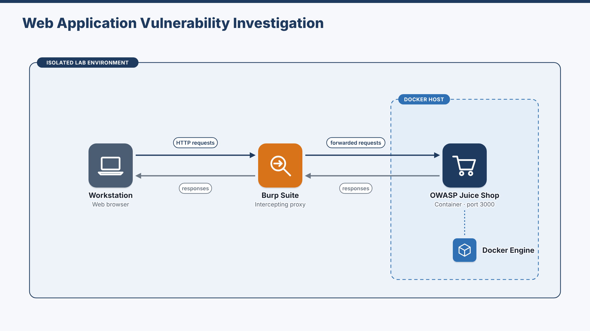

Juice Shop ran locally in Docker. Browser traffic was inspected with **Burp Suite** and the browser's **developer tools**, and supporting work was done from a **Kali Linux** VM.

## My contribution

Within the four-person team, I solved five challenges rated 4–6 stars and wrote the analysis of two vulnerability categories, **Sensitive Data Exposure** and **Security Misconfiguration**, covering root cause, how each exploit works, business impact and recommended mitigations. The team's SAST and DAST scans and the other challenge write-ups were done by my teammates.

## Challenges I solved

| Challenge | Difficulty | Vulnerability | How I solved it |
|-----------|-----------|---------------|-----------------|
| **Cross-Site Imaging** | ★★★★★ | Security Misconfiguration | Read the front-end source (`main.js`) and found a hidden `testDecal` URL parameter. Combined path traversal with an allow-listed redirect URL to load an external image in place of the Juice Shop logo. |
| **Login Support Team** | ★★★★★★ | Security Misconfiguration | Found a publicly reachable `/ftp` directory through the legal notice page and downloaded an exposed KeePass database. Extracted the hash with `keepass2john`, then built a targeted **John the Ripper** attack from the password policy regex in the JavaScript. Cracked the database and logged in with the support team's credentials. |
| **Reset Uvogin's Password** | ★★★★ | Sensitive Data Exposure | Found the user's email in product reviews. Used **OSINT** (username variations, then the **Wayback Machine** for a deleted post) to answer the security question and reset the password. |
| **Leaked Unsafe Product** | ★★★★ | Sensitive Data Exposure | Intercepted the product search API and confirmed **SQL injection** from database error messages. Built a payload that returned every product, including a hidden "unsafe" one, then traced its ingredients through external sources. |
| **Retrieve Blueprint** | ★★★★★ | Sensitive Data Exposure | Analysed product images for hidden data with Aperi'Solve and **ExifTool**. Metadata pointed to 3D-modelling software, which led to the exposed `.stl` blueprint file. |

*Exact answers and passwords are left out on purpose. This write-up shows the method, not a solutions list.*

## Vulnerability analysis

### Sensitive Data Exposure
- **Classification:** OWASP Top 10 A3:2017 Sensitive Data Exposure (A02:2021 Cryptographic Failures) · **CWE-200** Exposure of Sensitive Information to an Unauthorized Actor
- **Root cause:** sensitive data that isn't protected properly (no encryption, weak or deprecated algorithms, hard-coded keys), security questions based on publicly discoverable facts, and "deleted" records still returned by the API.
- **Impact:** identity theft, fraud, targeted phishing and loss of customer trust. The 2022 Optus breach is a real-world example, where a misconfigured API exposed millions of customer records.
- **Mitigation:** TLS 1.2+ with HSTS, AES-256-GCM encryption at rest, Argon2id password hashing with unique salts, managed key storage (AWS KMS / Azure Key Vault), data classification, and OWASP ASVS V7/V9/V10 as development checkpoints.

### Security Misconfiguration
- **Classification:** OWASP Top 10 A02:2025 Security Misconfiguration · **CWE-16** Configuration · **CWE-276** Incorrect Default Permissions
- **Root cause:** no repeatable, automated hardening process, which leaves directories exposed, insecure defaults in place and debug features reachable in production.
- **Impact:** an initial foothold for wider compromise, privileged access and data theft. The 2022 Uber breach is a real-world example, where hard-coded credentials gave attackers access to privileged systems.
- **Mitigation:** minimal-platform hardening, credential rotation and MFA on admin interfaces, standard security headers and a WAF, Infrastructure as Code with policy-as-code baselines, generic error handling, and continuous configuration monitoring (OWASP ASVS V14, CIS Benchmarks).

## Tools and techniques

Burp Suite · browser developer tools (Sources, Network) · Docker · Kali Linux · John the Ripper and `keepass2john` · KeePass · OSINT (username search, Wayback Machine) · Aperi'Solve and ExifTool · SQL injection · path traversal · OWASP Top 10 · MITRE CWE

## Evidence

| | |
|---|---|
| 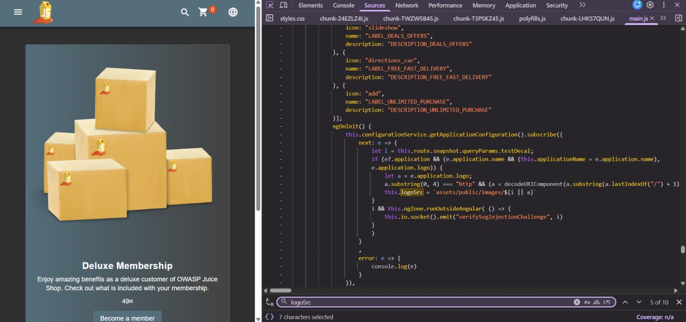 **Cross-Site Imaging**: finding the hidden `testDecal` parameter in `main.js` | 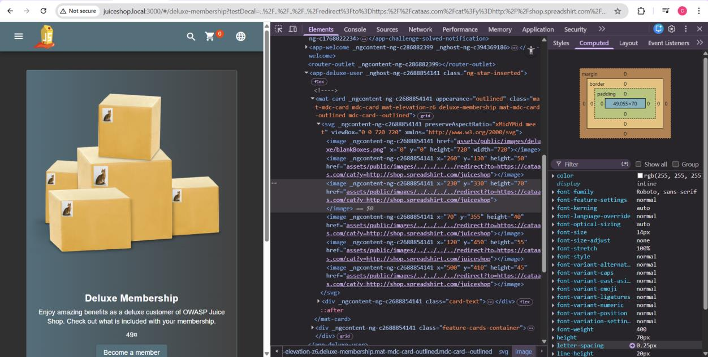 **Cross-Site Imaging**: crafted URL loading an external image |
| 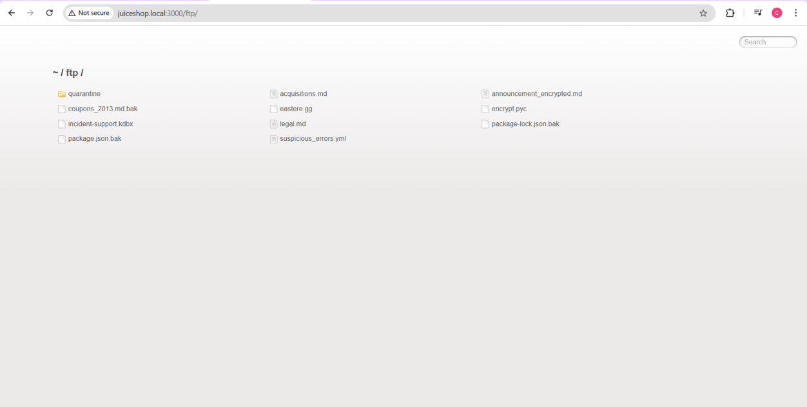 **Login Support Team**: publicly exposed `/ftp` directory | 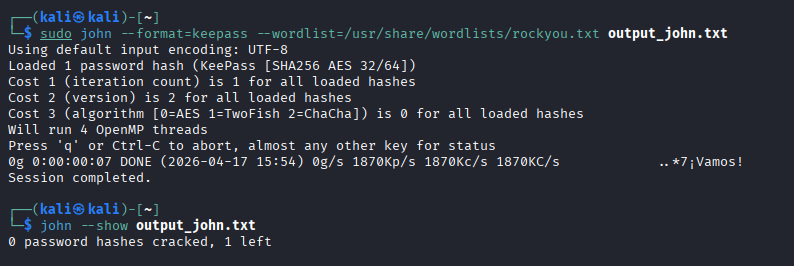 **Login Support Team**: offline cracking with John the Ripper |
| 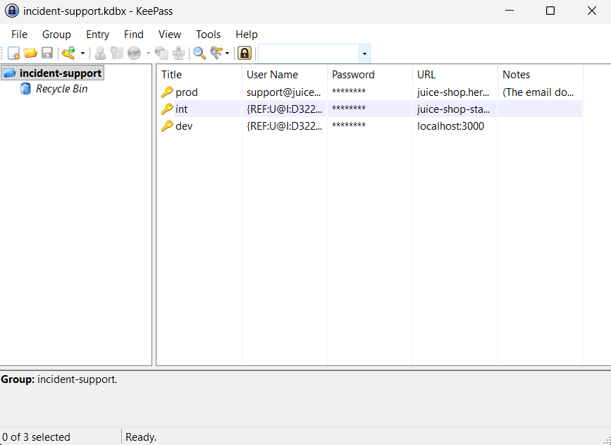 **Login Support Team**: KeePass database opened | 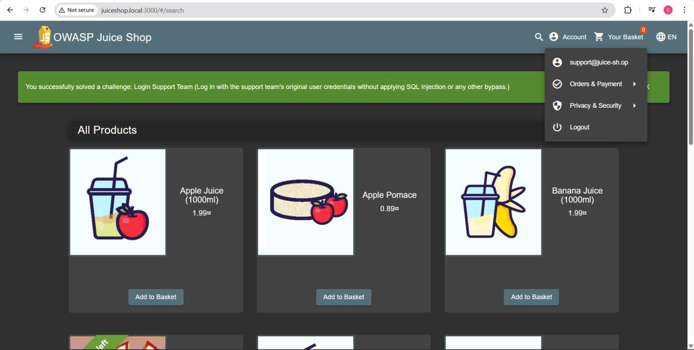 **Login Support Team**: logged in as the support team |
| 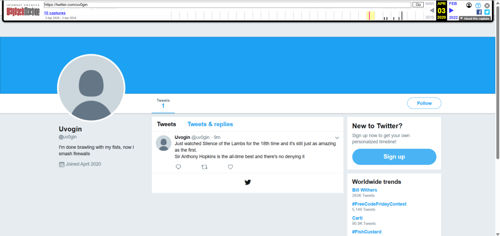 **Reset Uvogin's Password**: OSINT with the Wayback Machine | 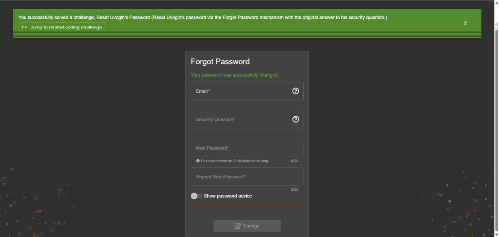 **Reset Uvogin's Password**: challenge solved |
| 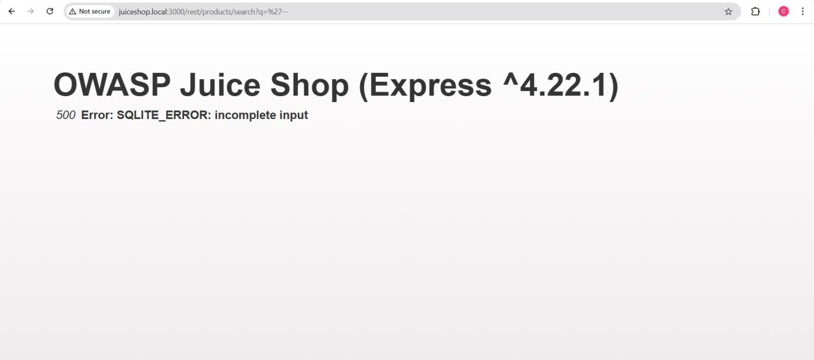 **Leaked Unsafe Product**: SQL error confirms injection | 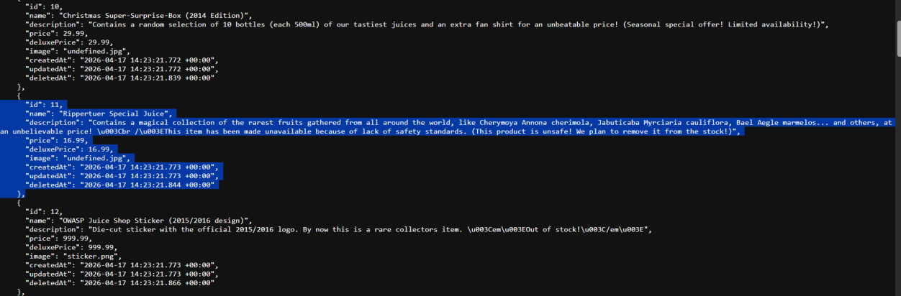 **Leaked Unsafe Product**: injection returns the hidden product |
| 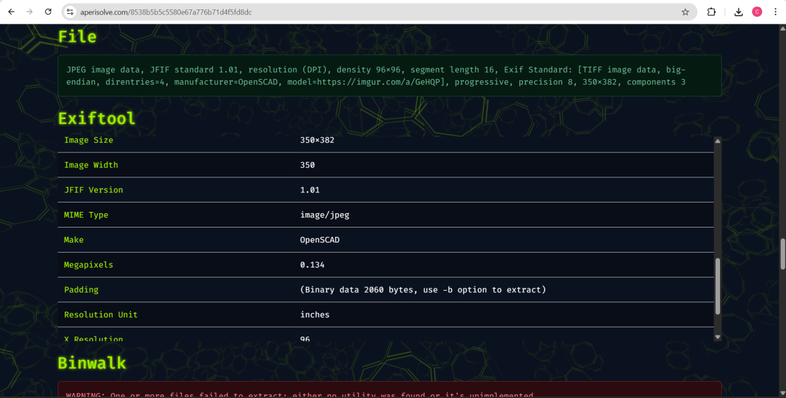 **Retrieve Blueprint**: image metadata revealing the 3D-modelling software | |

## What this project demonstrates

Hands-on web application penetration testing in a safe, legal environment: reading client-side code, intercepting and manipulating requests, SQL injection, offline password cracking, OSINT and image forensics. It also shows I can turn findings into clear root-cause, impact and mitigation analysis mapped to OWASP and CWE, and work as part of a team.
